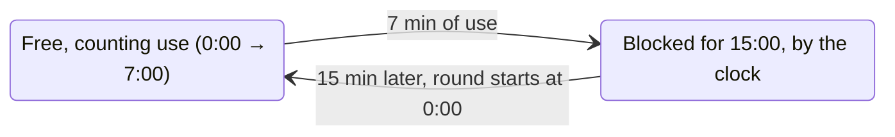
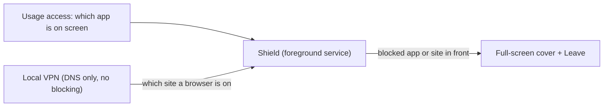

# Maverick Truck

**Instagram and YouTube on Android, on a short leash: 7 minutes of use, then 15 minutes blocked.**

The app and the site, in any browser. No account, no server, no accessibility service. It does not cut your internet: when your time is up, it puts a full-screen cover over the app (or sends the browser Home) until the block ends.

Maverick Truck is the phone sibling of [Maverick](https://github.com/luiz-nast/maverick), the Linux desktop app that limits YouTube and runs Instagram on the same kind of cycle. Maverick is the car; this is the truck.

| | |
|---|---|
| Version | 0.1.0 |
| Platform | Android 10+ (tested target: Android 16, Galaxy S24 FE) |
| Language | Kotlin, Jetpack Compose |
| Size | ~1.5 MB |
| Permissions | Usage access, local VPN, cover blocked apps, notifications, unrestricted battery |
| Network | Nothing goes to any server of ours: there is none |
| App ID | `io.github.luiz_nast.maverick.truck` |
| License | MIT |

## The cycle

One leash for both. Instagram and YouTube share the same 7 minutes of use, and the 15-minute block covers both at once — so you cannot jump from a blocked Instagram to YouTube.



| Situation | Counts toward the 7 min? |
|---|---|
| Instagram or YouTube app on screen | Yes, 1 s per second |
| instagram.com or youtube.com open in a browser on screen | Yes (see "How a site is noticed") |
| The app open but the screen off | No |
| Any other app on screen | No |
| The phone in your pocket during a block | The block keeps running: it is by the clock |

When a round runs out, a full-screen cover drops over the blocked app with "Instagram is blocked — free again at 14:32" and a **Leave** button that goes Home (`Cobertura`, the "Display over other apps" permission — not an accessibility service, so banks do not flag it). The cover appears only over the Instagram and YouTube apps, never over a bank or any other app. A notice also drops from the top. A quiet ongoing notification keeps the score: `Instagram & YouTube · 3:12 of 7:00 used`.

You can turn the shield off from the app, but only while nothing is blocked. That is the whole point.

## How it works



1. **It counts, it does not cut.** Every second the screen is on, the shield sees which app is in front. If it is Instagram or YouTube (the app, or a browser on the site), it adds to that site's round. At 7 minutes the site is blocked for 15 minutes by the clock. Your internet is never touched.
2. **A floating counter while you scroll.** While Instagram or YouTube is in front and still free, a small pill shows the shared time, "YouTube 5:12 / 7:00", greener to redder as it fills (`Medidor`) — the same idea as the desktop Maverick's counter. You can drag it anywhere and it stays there; it shows only over those apps.
3. **Blocked means you are thrown out.** While a site is blocked and its app is in front, a full-screen cover appears over it — "Instagram is blocked — free again at 14:32" — with a **Leave** button that goes Home (`Cobertura`). A browser sitting on a blocked site gets the same cover. The cover shows only over the Instagram and YouTube apps and over a browser on those sites: never over a bank, the alarm, or anything else.
4. **Seeing a browser's site needs the DNS tunnel.** Without an accessibility service, the only way to know a browser is on youtube.com is the DNS it asks for. So the shield is a local VPN whose single route is a fake DNS server (`10.215.173.2`); every app's DNS question passes through, the shield notes the ones for Instagram and YouTube (and who asked), and forwards every question to your real DNS and hands the answer straight back. It blocks nothing and your traffic never goes through it. Answers for ruled names get a 10-second lifetime so the browser keeps asking, which is how the shield knows it is still on the site.
5. **Usage comes from Android's usage history** (the "Usage access" permission), read once per second while the screen is on.

### How a site is noticed

A browser is on screen, and that same browser asked for a ruled name in the last 60 s (Android tells a VPN who owns a connection; when it does not say, the question still counts). A question from another app, such as YouTube Music playing in the background or a link preview in WhatsApp, does not count. This is approximate: a page that only embeds a YouTube player or an Instagram post counts as that site.

### Who stays outside the tunnel

The app itself (it is the way out to the real DNS), banks (Nubank, Inter, Itaú, Banco do Brasil, Bradesco, Santander, Caixa, Mercado Pago, PicPay) and [Tourbillon Alarm](https://github.com/luiz-nast/tourbillon-alarm). Their DNS never passes through, and nothing of theirs is ever covered.

## Install

There is no Play Store release. With the phone on a USB cable and USB debugging on:

```bash
./install.sh
```

or build and install by hand:

```bash
./gradlew assembleRelease
adb install -r app/build/outputs/apk/release/app-release.apk
```

Then open **Maverick Truck** and:

1. **Usage access** › Allow › find Maverick Truck › on.
2. **Notifications** › Allow (Android 13+).
3. **Unrestricted battery** › Allow (Samsung and others put background apps to sleep).
4. **Cover blocked apps** › Allow (so a block screen can appear over Instagram and YouTube).
5. **TURN ON** › Android asks once to let it set up a VPN › OK. A key icon shows in the status bar while the shield is up.

It comes back by itself after a reboot or an update.

**Private DNS.** If Settings › Connections › More connection settings › Private DNS is set to a provider (for example `dns.google`), Android sends DNS straight to that provider and the shield never sees a browser's site (the apps are still caught by usage). The app shows a red warning in that case. Set it to **Automatic** (or Off).

## Why not an accessibility service?

Most app blockers watch the screen through an accessibility service and press Home on the blocked app. On Android 13+, an app that is not from the Play Store and has an accessibility service on is exactly what the "app access risk" check of banking apps flags, because that is how remote-control scams work: Nubank refuses to open while one is on. The same owner hit that with Tourbillon Alarm in October 2026. So Maverick Truck uses only:

| Need | What it uses | Not this |
|---|---|---|
| Which app is on screen | Usage access (`UsageStatsManager`) | Accessibility service |
| Seeing a browser's site | Local VPN, DNS only (no blocking) | Accessibility |
| Taking you out of the app | A cover over that app only (`SYSTEM_ALERT_WINDOW`) | Accessibility (banks flag it) |
| Keeping time | A foreground service, 1 tick per second with the screen on | Polling with the screen off |

## Known limits

- **The cover needs its permission.** The block is the cover, so without "Display over other apps" nothing stops you — grant it. The cover appears up to 1 second after you open the blocked app (the shield looks once a second).
- **A browser leaving the site.** The shield reads a browser's site from its DNS, so for up to ~15 seconds after you leave Instagram/YouTube for another page in the *same browser* (even a bank page), the cover or pill can still show over it, until the shield sees the browser has moved on. In the app itself this never happens (usage is exact).
- **DNS over TCP** to the shield is not answered. Android uses it only for answers too big for UDP (rare with modern resolvers); such a name can fail to resolve while the shield is on. Set Private DNS to Automatic, not a fixed provider.
- **Turning it off is possible from Android**: Settings › VPN, or the VPN tile, or uninstalling. Maverick Truck is a seatbelt, not a jail. It notifies you when the shield goes down.
- **Another VPN replaces it.** Android runs one VPN at a time.
- **Private DNS set to a provider** bypasses the shield (see above).
- **A browser with its own encrypted DNS** set to a fixed provider (Chrome › Settings › Privacy › Use secure DNS › custom provider) bypasses it for sites. Chrome's default ("automatic", with your current provider) is fine.
- **The app and the site count differently**: the app by what is on screen (exact), the site by the browser's DNS questions (approximate, see above).
- **Wall clock.** Blocks follow the phone's clock. Setting the clock back does not stretch a block beyond 15 min; setting it forward ends it early.

## Files

| File | What it does |
|---|---|
| `Regras.kt` | Pure rules, tested: the two sites (`Site`: packages, ruled domains), `siteDoDominio`, the round (`Rodada.avancar`, `LIVRE_MS` = 7 min, `BLOQUEIO_MS` = 15 min), `siteEmUso` (with who asked: `Consulta`) |
| `Dns.kt` | Pure packet work, tested: read a DNS question from an IPv4/UDP packet (`lerPerguntaDns`), the question name, the 10 s TTL rewrite (`encurtarTtl`), build an IPv4/UDP packet with both checksums |
| `Escudo.kt` | The `VpnService`: the 1 s tick (usage, rounds, notices, the cover), the DNS-only tunnel (never blocks; rebuilt only if its reader dies), the reader thread (`Os.poll`), forwarding to the real DNS through protected sockets (re-read on every network change), who asked (`getConnectionOwnerUid`) |
| `Uso.kt` | Which app is on screen (`UsageStatsManager.queryEvents`), whether usage access is granted, which apps are browsers |
| `Estado.kt` | What is saved on the phone: on/off and the single shared round (Instagram + YouTube); the screen reads it as `StateFlow` |
| `Notificacoes.kt` | The ongoing status notification and the "blocked" heads-up |
| `MainActivity.kt` | The screen: the shared "Instagram & YouTube" ring, TURN ON / Turn off, permissions, the Private DNS warning |
| `Cobertura.kt` | The full-screen cover shown over a blocked app while it is in front (`SYSTEM_ALERT_WINDOW`); never over a bank |
| `Medidor.kt` | The small floating pill (same permission) with "used / 7:00", shown while Instagram or YouTube is in front and still free; drag it anywhere and it remembers the spot; like the desktop Maverick's counter; never over a bank |
| `BootReceiver.kt` | Brings the shield back after a reboot or an app update |

Code and comments are in Portuguese, like the sibling projects; everything on screen is in English. Logs: `adb logcat -s Maverick`.

## Design decisions

- **Usage-based, then clock-based.** The 7 minutes are of real use, so an idle phone does not burn them, and the 15 minutes are by the clock, so a block cannot be waited out with the screen off any faster. It matches Maverick on the desktop.
- **One leash for both (owner, 2026-10-31).** The 7 minutes are Instagram and YouTube together, and the block covers both, so a blocked Instagram cannot be dodged by opening YouTube.
- **Eject, do not cut.** Cutting the network left the already-loaded feed scrolling and never took you off the screen, so it did not feel like a block. A cover over the app does. The DNS tunnel stays only as a sensor, to tell when a browser is on a blocked site; it forwards every question untouched, so it cannot slow a download or break an app that is not ruled.

- **Stop only when nothing is blocked.** Turning off in the middle of a block would make the block a suggestion.

## Build

JDK 17+ and the Android SDK. `./gradlew testDebugUnitTest` runs the rule and packet tests; `./gradlew assembleRelease` builds the APK (signed with the debug key, which is enough for your own phone).

## License

MIT
