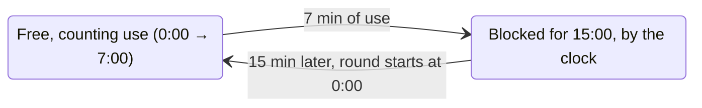
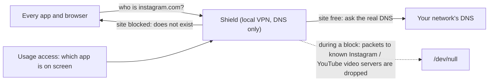

# Maverick Truck

**Instagram and YouTube on Android, on a short leash: 7 minutes of use, then 15 minutes blocked.**

The app and the site, in any browser. No account, no server, no accessibility service: a tiny VPN that never leaves the phone answers "this does not exist" for Instagram and YouTube while they are blocked.

Maverick Truck is the phone sibling of [Maverick](https://github.com/luiz-nast/maverick), the Linux desktop app that limits YouTube and runs Instagram on the same kind of cycle. Maverick is the car; this is the truck.

| | |
|---|---|
| Version | 0.1.0 |
| Platform | Android 10+ (tested target: Android 16, Galaxy S24 FE) |
| Language | Kotlin, Jetpack Compose |
| Size | ~1.5 MB |
| Permissions | Usage access, local VPN, notifications, unrestricted battery |
| Network | Nothing goes to any server of ours: there is none |
| App ID | `io.github.luiz_nast.maverick.truck` |
| License | MIT |

## The cycle

Each site has its own round. Instagram and YouTube never share minutes.



| Situation | Counts toward the 7 min? |
|---|---|
| Instagram or YouTube app on screen | Yes, 1 s per second |
| instagram.com or youtube.com open in a browser on screen | Yes (see "How a site is noticed") |
| The app open but the screen off | No |
| Any other app on screen | No |
| The phone in your pocket during a block | The block keeps running: it is by the clock |

When a round runs out, a notice drops from the top: *"Instagram blocked. Your 7 minutes are up. Free again at 14:32."* Opening the blocked app again shows the notice again. A quiet ongoing notification keeps the score: `Instagram 3:12 of 7:00 · YouTube blocked 11:40`.

You can turn the shield off from the app, but only while nothing is blocked. That is the whole point.

## How it works



1. **The shield is a VPN that only carries DNS.** The VPN's only route is a fake DNS server, `10.215.173.2`, that exists only inside the tunnel. Every app asks it for names; the shield passes the question to your network's real DNS, from outside the tunnel, and hands the answer back. Your traffic itself never goes through the shield.
2. **Blocked means "does not exist".** While a site is blocked, its names (`instagram.com`, `cdninstagram.com`, `youtube.com`, `googlevideo.com`, `ytimg.com`, `youtubei.googleapis.com`, …) get an instant NXDOMAIN. Apps and browsers give up at once instead of hanging.
3. **Open connections are cut too.** While a site is free, the shield remembers the public addresses the DNS gave for Instagram's servers and CDN (`*.instagram.com`, `*.cdninstagram.com`, `instagram.*.fbcdn.net`) and for YouTube's video cache servers (`rrN---sn-….googlevideo.com`, nothing else under googlevideo.com). When the block starts, the tunnel is rebuilt with those addresses routed into it, and packets to them are dropped, so even a video that was already playing stops. Google's general front-end addresses (behind `youtube.com`, `ytimg.com`, `manifest.googlevideo.com`, which also serve Search, Gmail and the Play Store) are never routed: those are blocked by DNS only. Meta may serve Threads from some of the same Instagram addresses, so Threads can stall during an Instagram block.
4. **Short answers for ruled names.** Answers for Instagram and YouTube names go out with a 10-second lifetime (TTL), so Android and the browser ask again soon: browser use shows up, and a new block bites within seconds instead of waiting for cached answers to expire.
5. **Usage comes from Android's usage history** (the "Usage access" permission), read once per second while the screen is on.

### How a site is noticed

A browser is on screen, and that same browser asked for a ruled name in the last 60 s (Android tells a VPN who owns a connection; when it does not say, the question still counts). A question from another app, such as YouTube Music playing in the background or a link preview in WhatsApp, does not count. This is approximate: a browser keeps reusing an open connection, so a long video may stop counting after a minute without new questions, and a page that only embeds a YouTube player or an Instagram post counts as that site.

### Who stays outside the shield

The app itself (it is the way out to the real DNS), banks (Nubank, Inter, Itaú, Banco do Brasil, Bradesco, Santander, Caixa, Mercado Pago, PicPay) and [Nightmare Alarm](https://github.com/luiz-nast/nightmare-alarm). Nothing from them passes through the tunnel.

## Install

There is no Play Store release. With the phone on a USB cable and USB debugging on:

```bash
./install.sh
```

or build and install by hand:

```bash
./gradlew assembleRelease
adb install -r app/build/outputs/apk/release/app-release.apk
```

Then open **Maverick Truck** and:

1. **Usage access** › Allow › find Maverick Truck › on.
2. **Notifications** › Allow (Android 13+).
3. **Unrestricted battery** › Allow (Samsung and others put background apps to sleep).
4. **TURN ON** › Android asks once to let it set up a VPN › OK. A key icon shows in the status bar while the shield is up.

It comes back by itself after a reboot or an update.

**Private DNS.** If Settings › Connections › More connection settings › Private DNS is set to a provider (for example `dns.google`), Android sends DNS straight to that provider and the shield never sees the names. The app shows a red warning in that case. Set it to **Automatic** (or Off).

## Why not an accessibility service?

Most app blockers watch the screen through an accessibility service and press Home on the blocked app. On Android 13+, an app that is not from the Play Store and has an accessibility service on is exactly what the "app access risk" check of banking apps flags, because that is how remote-control scams work: Nubank refuses to open while one is on. The same owner hit that with Nightmare Alarm in October 2026. So Maverick Truck uses only:

| Need | What it uses | Not this |
|---|---|---|
| Which app is on screen | Usage access (`UsageStatsManager`) | Accessibility service |
| Blocking | Local VPN, DNS only | Overlay over other apps, accessibility |
| Keeping time | A foreground service, 1 tick per second with the screen on | Polling with the screen off |

## Known limits

- **Turning it off is possible from Android**: Settings › VPN, or the VPN tile, or uninstalling. Maverick Truck is a seatbelt, not a jail. It notifies you when the shield goes down.
- **Another VPN replaces it.** Android runs one VPN at a time.
- **Private DNS set to a provider** bypasses the shield (see above).
- **A browser with its own encrypted DNS** set to a fixed provider (Chrome › Settings › Privacy › Use secure DNS › custom provider) bypasses it for sites. Chrome's default ("automatic", with your current provider) is fine.
- **Cached content stays.** A post already on screen stays on screen; what is cut is everything new. Only the video servers' and Instagram's own addresses are cut mid-connection; the rest of YouTube relies on DNS, so an app that keeps a connection to a shared Google address open may load a little more before it stops.
- **IPv6**: addresses learned from IPv6 answers are cut too; a server never seen before by the shield is blocked by DNS only. IPv6 traffic itself always goes straight to the network, like IPv4.
- **DNS over TCP** to the shield is not answered. Android uses it only for answers too big for UDP, which modern resolvers avoid.
- **The app and the site count differently**: the app by what is on screen (exact), the site by the browser's DNS questions (approximate, see above).
- **Wall clock.** Blocks follow the phone's clock. Setting the clock back does not stretch a block beyond 15 min; setting it forward ends it early.

## Files

| File | What it does |
|---|---|
| `Regras.kt` | Pure rules, tested: the two sites (`Site`: packages, ruled domains, domains whose addresses are cut), `siteDoDominio`, `guardaEnderecos`, the round (`Rodada.avancar`, `LIVRE_MS` = 7 min, `BLOQUEIO_MS` = 15 min), `siteEmUso` (with who asked: `Consulta`) |
| `Dns.kt` | Pure packet work, tested: read a DNS question from an IPv4/UDP packet (`lerPerguntaDns`), the question name, an NXDOMAIN answer, the A/AAAA addresses of an answer, the 10 s TTL (`encurtarTtl`), public addresses only (`enderecoPublico`), build an IPv4/UDP packet with both checksums |
| `Escudo.kt` | The `VpnService`: the 1 s tick (usage, rounds, notices), the tunnel (rebuilt only when the set of blocked sites changes, or when its reader dies), the reader thread (`Os.poll`), forwarding to the real DNS through protected sockets (re-read on every network change), who asked (`getConnectionOwnerUid`), the block end with the screen off |
| `Uso.kt` | Which app is on screen (`UsageStatsManager.queryEvents`), whether usage access is granted, which apps are browsers |
| `Estado.kt` | What is saved on the phone: on/off, each site's round, the learned addresses (at most 200 per site); the screen reads it as `StateFlow` |
| `Notificacoes.kt` | The ongoing status notification and the "blocked" heads-up |
| `MainActivity.kt` | The screen: one ring per site, TURN ON / Turn off, permissions, the Private DNS warning |
| `BootReceiver.kt` | Brings the shield back after a reboot or an app update |

Code and comments are in Portuguese, like the sibling projects; everything on screen is in English. Logs: `adb logcat -s Maverick`.

## Design decisions

- **Usage-based, then clock-based.** The 7 minutes are of real use, so an idle phone does not burn them, and the 15 minutes are by the clock, so a block cannot be waited out with the screen off any faster. It matches Maverick on the desktop.
- **One round per site.** Using up Instagram does not touch YouTube.
- **DNS only, never the traffic.** A full VPN would need a user-space TCP/IP stack and would put every byte of every app through this code. A DNS-only tunnel is a few hundred lines, cannot slow down downloads and cannot break an app that is not ruled.
- **Rebuild the tunnel only at the edges of a block.** Android treats each rebuild as a new network (its DNS cache starts empty, which also helps the block bite), so it happens twice per block and never in between.
- **Stop only when nothing is blocked.** Turning off in the middle of a block would make the block a suggestion.

## Build

JDK 17+ and the Android SDK. `./gradlew testDebugUnitTest` runs the rule and packet tests; `./gradlew assembleRelease` builds the APK (signed with the debug key, which is enough for your own phone).

## License

MIT
